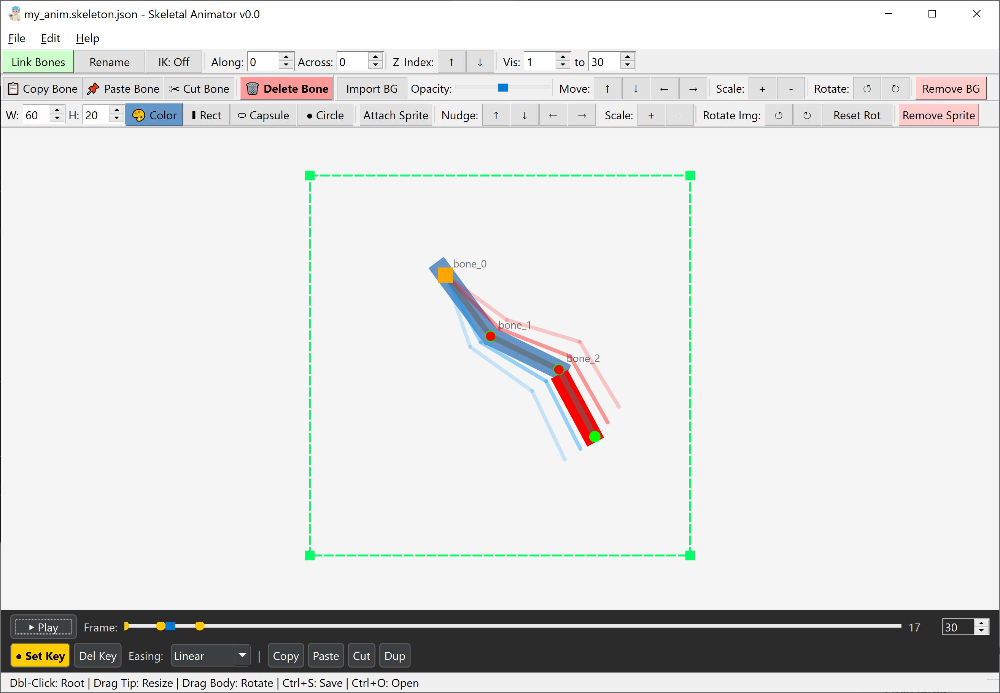
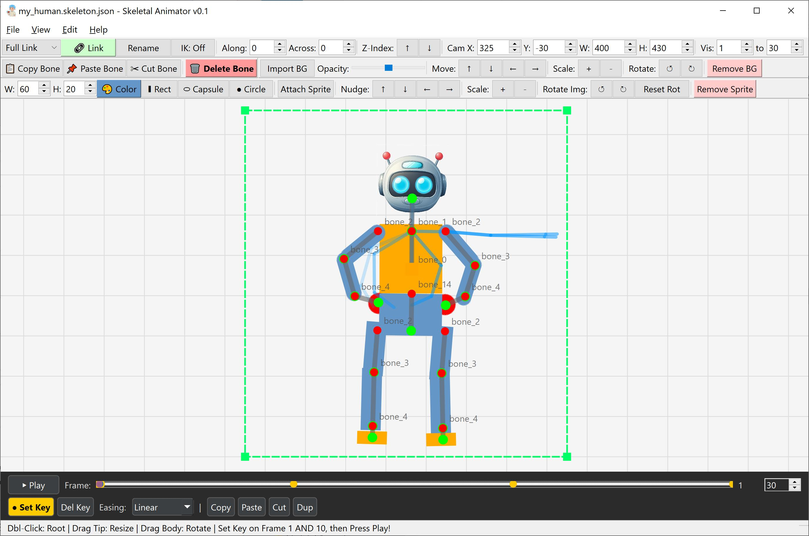
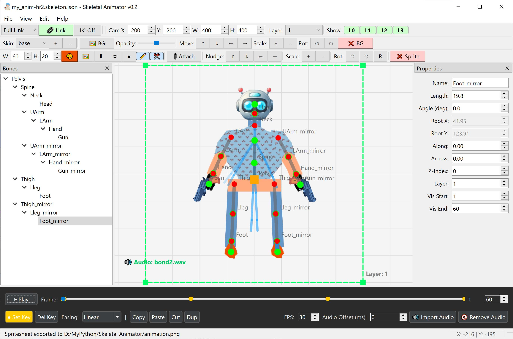

🦴 Skeletal Animator (v0.2.1)

A professional, offline 2D cutout animation studio for animators and game developers. Build flexible bone skeletons, attach sprites or custom polygons, and bring your characters to life using an intuitive timeline, Inverse Kinematics, audio sync, and cinematic camera keyframing.

Whether you are rigging a character for an indie game, creating a smooth 2D animation, or setting up lip-sync with audio, Skeletal Animator provides a complete studio environment. Export your work as standard spritesheets (PNG+JSON) for your game engine, or render high-quality videos (MP4, WebM, GIF) with transparent background support and baked-in audio!

This is the v0.2.1 release of the Skeletal Animator.

---
<table>
<tr>
<td>Figure 1. A snapshot of the Skeletal Animator, version 0.0
</td>
<td>Figure 2. A snapshot of the Skeletal Animator, version 0.1
</td>
</tr>
</table>

<tr>
<td>
Figure 3. A snapshot of the Skeletal Animator, version 0.2.1
</td>
</tr>
---

## 📥 Download the App (Windows)

The main application is provided as a standalone Windows executable (for Windows 10 and over). You don't need Python installed to use it!

**[⬇️ Download skeletal_animator.exe](https://github.com/ostad-ai/Skeletal-Animator/releases/tag/v0.2.1)**

1. Download the `.exe` file.
2. Double-click to run.
3. Start animating immediately!

---

## 🆕 What's New in v0.2.1?

- **Unlink Bone:** You can now easily detach a bone from its parent (`Ctrl+U`) without losing its current position or angle!
- **Mirror Tool Overhaul:** Fixed mirroring child bones. You can now perfectly mirror complex chains (like an arm attached to a torso), regardless of how the parent is rotated. Attachment offsets (Along/Across) are now correctly reflected.
- **Properties Panel - Layers:** You can now change a bone's Layer assignment directly from the Properties Panel, making it much easier to organize your rig.
- **Audio Fixes:** Fixed an issue where the audio indicator stayed on the canvas after removing audio. Also fixed a bug where audio would unexpectedly stop during playback.
- **App Icon:** Fixed the Windows taskbar and executable icon not displaying correctly.

---

## 🆕 What's New in v0.2?

- **Multiple Skins:** Create and switch between multiple outfits per character (base, summer, winter, etc.).
- **Custom Polygon Tool:** Draw custom shapes, edit vertices, add/delete points on the fly.
- **Pattern Fill:** Fill primitives and polygons with texture images instead of solid colors.
- **Audio Import & Lip-Sync:** Import audio files, sync them with the timeline, and set FPS/Audio Offset for perfect playback.
- **Bone Outliner:** A hierarchy tree panel to easily select and manage bones by name.
- **Properties Panel:** Edit bone properties (Length, Angle, Position, Z-Index, Visibility) with exact numbers.
- **Bone Layers:** Assign bones to Layer 0-3 and toggle visibility per layer.
- **Mirror Tool:** Mirror bones horizontally or vertically with perfect skin and angle mirroring.
- **Video Export with Audio:** Exported videos now include imported audio!
- **Bug Fixes:** Fixed bone orientation loss when parenting, fixed timeline range, improved UI layout, and more.

---

## 🆕 What's New in v0.1?

- **Pos-Only Link:** A new dropdown option in the toolbar. Link bones by position only, keeping their rotation independent. Perfect for torches, guns, or floating UI elements that shouldn't rotate with the hand!
- **Grid Toggle:** Press `Ctrl+G` (or use the View menu) to instantly show or hide the canvas grid.
- **Camera Controls:** Precise `Cam X/Y/W/H` spinboxes added to the toolbar for exact camera positioning.
- **Smooth Zoom:** High-precision zoom that feels buttery smooth on trackpads and mice.
- **Bug Fixes:** Fixed bone orientation loss when parenting, fixed timeline range syncing, and various UI polish improvements.

---

## ✨ Features

- **Rigging & IK:** Create bone chains, parent them with attachment offsets, and use Inverse Kinematics to automatically bend limbs naturally. Includes Pos-Only links for torches/guns.
- **Skinning:** Import PNG sprites, generate primitive shapes (Rect, Capsule, Circle), or draw custom Polygons. Supports non-uniform scaling and texture pattern fills.
- **Multiple Skins:** Create multiple outfits for your character (base, summer, winter, armor). Switch between skins instantly from the toolbar!
- **Bone Layers:** Assign bones to Layer 0-3. Toggle visibility per layer to hide weapons, clothes, or background characters.
- **Animation Studio:** Professional timeline with Keyframes, Easing (Linear, Ease In, Out, In-Out), and Onion Skinning (adjustable past/future ghosts).
- **Camera & Visibility:** Keyframe a camera viewport (Clip Window) to pan and zoom across your animation. Set visibility ranges so bones only appear on specific frames.
- **Audio Import & Lip-Sync:** Import audio files (MP3, WAV, OGG) and sync them with the timeline. Set FPS and Audio Offset for perfect synchronization. Ideal for manual lip-sync workflows!
- **Mirror Tool:** Mirror bones horizontally (Ctrl+M) or vertically (Ctrl+Shift+M). Skins, angles, and offsets are perfectly mirrored!
- **Workspace:** Bone Outliner (hierarchy tree), Properties Panel (exact numerical editing), Focus Mode (F) for maximum canvas space, and Timeline Toggle (T).
- **Export:**
  - **Spritesheet:** PNG grid + metadata JSON for your game engine.
  - **Video:** MP4, WebM, MOV, or GIF. Supports transparent backgrounds for game engines. Audio is baked into video exports!

---

## 💻 For Developers: Python Demo

To use the exported spritesheets in your own Python games, a demo script is provided in this repository.

### `demo_spritesheet.py`
A fully runnable Pygame demo that automatically reads the exported metadata JSON and plays the spritesheet animation smoothly.
* **To run:** 
  1. `pip install pygame`
  2. Export a track as `animation.png` and `animation.json` from the main app.
  3. Run `python demo_spritesheet.py`.
* **Controls:** `ESC` to Exit.

---

🌟 Support

If Skeletal Animator helps you bring your characters to life, please consider supporting us by giving this repository a ⭐ on GitHub! It helps other animators and developers discover the tool and fuels our future updates (and our virtual chai ☕)

---

## ❤️ Credits

Developed by Hamed Shah-Hosseini, under the V star (with lots of virtual chai). ☕

Built with Math, and a passion for animation and game development.

---
